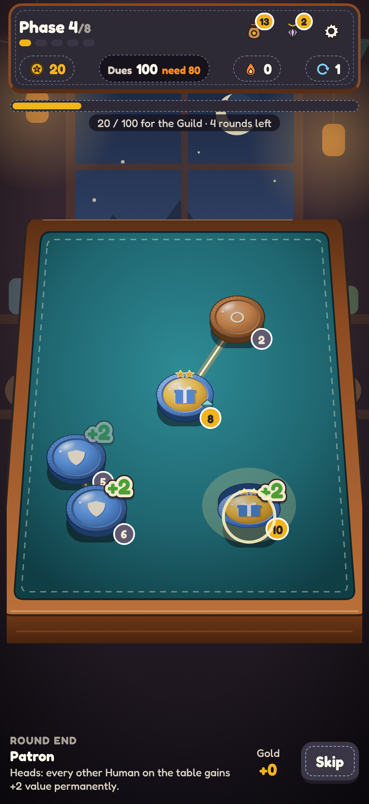
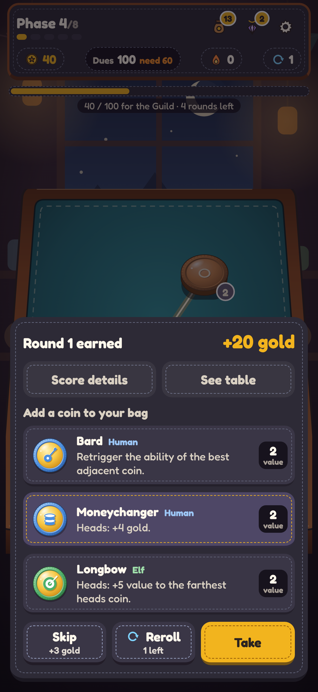
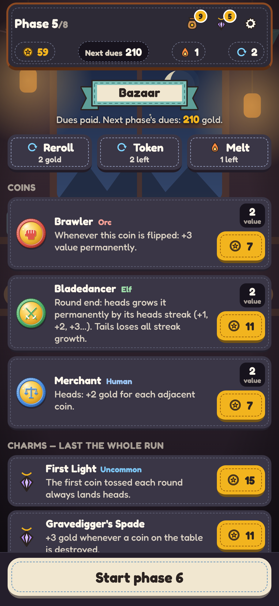

# Coinfall

An original roguelike coin-toss bag builder for iPhone, built with Expo and TypeScript.

You are a moneylender at a crossroads bazaar where Humans, Orcs and Elves gamble. Toss coins, grow your bag, and pay the Lenders' Guild its dues at the end of every phase. Survive 8 phases to win.

**Play in your browser:** https://sol-aide.github.io/coinfall/

<p>
  
  
  
</p>

## How to play

1. **Choose a patron.** Each run starts with 5 Copper, a Squire (Human), a Grunt (Orc) and an Archer (Elf). Pick a starting Charm for Humans, Orcs or Elves.
2. **Toss coins.** Each round, 5 coins are drawn from your bag and land on the table, heads or tails. Heads pay their value in gold; tails pay nothing unless an ability says otherwise.
3. **Watch the abilities.** Abilities resolve in order: round start → each coin lands → adjacency (dashed lines show neighbours) → round end → scoring. Tap any coin to read it.
   - **Humans** – economy and teamwork (Merchant, Squire, Bard, Guildmaster…)
   - **Orcs** – big values and chaos (Berserker, Charger, Firebrand, Warlord…)
   - **Elves** – precision and control (Sentinel, Moon Priestess, Bladedancer, Longbow…)
4. **Grow your bag.** After each round, add 1 of 3 coins or skip for 3 gold. Three identical coins fuse into a stronger one.
5. **Pay the Guild.** Every 5 rounds the Guild collects dues (22 gold, rising to 375 by phase 8). If you can't pay, the run ends.
6. **Shop at the bazaar.** Buy coins, Charms (run-wide passives, up to 6) and Engravings (upgrades for one coin). Reroll the stock, and use Melt tokens to remove weak coins.

The full rules, every coin, Charm and Engraving, balance data and design decisions are in [DESIGN.md](DESIGN.md). All currencies are play money — there are no purchases, ads, accounts or tracking.

## Run it on your PC and play on your iPhone

Requirements: [Node.js](https://nodejs.org) 20.19 or newer (22 LTS recommended), and the free **Expo Go** app on your iPhone.

```bash
git clone https://github.com/sol-aide/coinfall.git
cd coinfall
npm install
npx expo start
```

- **On iPhone:** open the Camera app, scan the QR code shown in the terminal, and tap the banner to open the game in Expo Go. Your PC and iPhone need to be on the same Wi‑Fi network (if they can't see each other, run `npx expo start --tunnel`).
- **In a browser:** press `w` in the terminal, or run `npm run web`.

Other commands:

| Command | What it does |
|---|---|
| `npm test` | Jest tests for the engine (every trigger, fusion, dues, shop pricing, full seeded runs) and content checks |
| `npx tsc --noEmit` | Type-check |
| `npm run simulate -- 1000 --detail` | Balance simulation: 1,000 bot runs per strategy |
| `npx expo export -p web` | Static web build into `dist/` |
| `npx tsx scripts/content-tables.ts` | Prints the content tables used in DESIGN.md |
| `npx tsx scripts/make-save.ts <seed> <phase> <ready\|shop\|dues>` | Generates a save at a given point (for playtesting; paste into the browser's `localStorage` key `coinfall.run.v1`) |

## Web version (GitHub Pages)

`.github/workflows/pages.yml` type-checks, tests, builds the web version and deploys it to GitHub Pages on every push to `main`. The web base URL is set to `/coinfall` in `app.json` (`experiments.baseUrl`), matching the repository name.

**One-time setup:** in the repository on GitHub, open **Settings → Pages** and set **Source** to **GitHub Actions**. After the next push to `main` the game is live at https://sol-aide.github.io/coinfall/.

## Future steps: a real iPhone app on the App Store

Expo Go is great for playing and testing. To ship Coinfall as its own app you build it with EAS (Expo Application Services):

1. **Apple Developer Program.** Enrol at developer.apple.com (yearly fee). You'll need it for TestFlight and the App Store.
2. **Install the EAS CLI and log in** with a free Expo account:
   ```bash
   npm install -g eas-cli
   eas login
   eas build:configure
   ```
   This creates `eas.json` with `development`, `preview` and `production` profiles. The bundle identifier `com.solaide.coinfall`, icon, splash screen and iOS privacy manifest are already set in `app.json`.
3. **Build for iOS in the cloud** (no Mac required):
   ```bash
   eas build --platform ios --profile production
   ```
   EAS asks for your Apple account and creates the signing certificate and provisioning profile for you.
4. **Test with TestFlight:**
   ```bash
   eas submit --platform ios --latest
   ```
   This uploads the build to App Store Connect. Once Apple finishes processing it (usually minutes), add yourself and other testers in App Store Connect → TestFlight and install the TestFlight app on your iPhone.
5. **Submit to the App Store.** In App Store Connect, fill in the listing using [APP_STORE.md](APP_STORE.md) (name, subtitle, description, keywords, age-rating answers, review notes, screenshot plan), set the privacy policy URL to a hosted copy of [PRIVACY.md](PRIVACY.md), choose "Data Not Collected" for App Privacy, attach the build and submit for review.
6. **Updates:** bump `version` (and `ios.buildNumber`) in `app.json`, rebuild and resubmit. JavaScript-only fixes can also ship with `eas update` once EAS Update is configured.

If you ever add purchases, they must use Apple In-App Purchase (Guideline 3.1.1), and the privacy policy, App Privacy answers and APP_STORE.md must be updated.

## Project layout

```
App.tsx                 app entry: providers + Root
src/engine/             pure TypeScript game rules (no UI imports), seeded RNG
  content/              coins, charms, engravings as data
  __tests__/            Jest tests
src/ui/                 React Native UI (screens, table animation, SVG art)
scripts/                balance simulation and dev helpers
assets/                 icon, splash, favicon (+ SVG sources in assets/source)
store/screenshots/      draft App Store screenshots (6.9")
```

## Documents

- [DESIGN.md](DESIGN.md) — rules, all content, balance results, playtest log, decisions
- [APP_STORE.md](APP_STORE.md) — store listing draft and compliance checklist
- [PRIVACY.md](PRIVACY.md) — privacy policy (same text as the in-app Privacy screen)
- [CLAUDE.md](CLAUDE.md) — conventions for future development sessions
